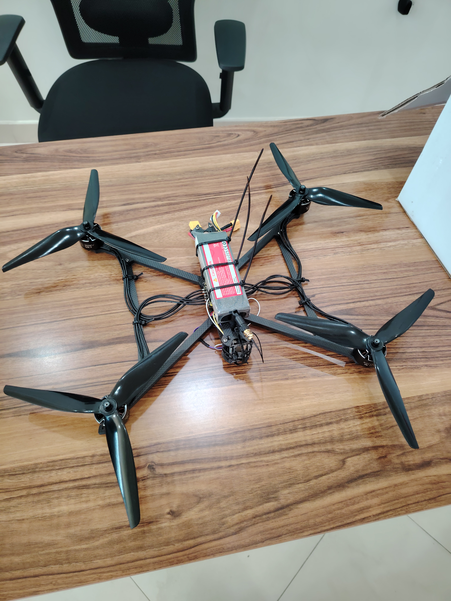
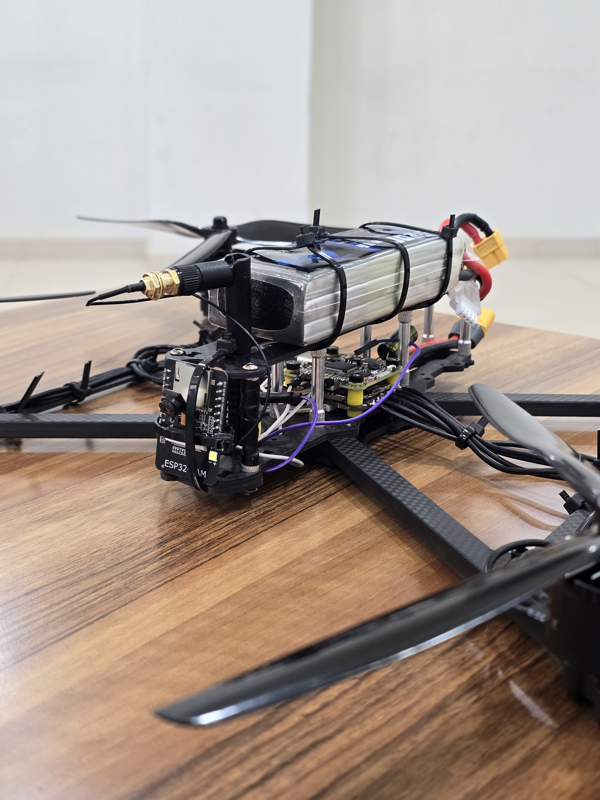
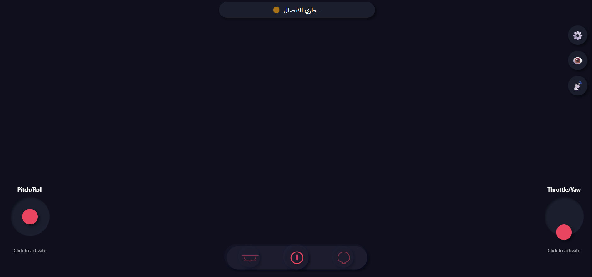
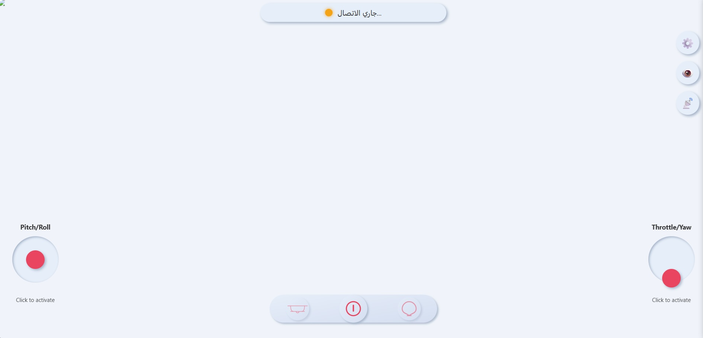

# WiFi Controlled UAV

A quadcopter flown from a web browser over WiFi. An **ESP32-CAM** sits between the pilot and the flight controller: it serves a camera stream, receives control commands over a WebSocket, and turns them into a **PPM signal** (GPIO14) that the SpeedyBee flight controller reads like a normal RC receiver. No radio transmitter is needed.

```
Browser UI <--> WebSocket <--> ESP32-CAM --> PPM (GPIO14) --> FC --> ESC --> Motors
```

## Features

- Touch/mouse control UI (sticks, throttle, arming, dark and light theme)
- Live camera stream from the onboard ESP32-CAM
- 8-channel PPM output with a fail-safe when the link is lost
- Password protection for settings page, control socket and video
- Settings page on the board (WiFi, ports, password)

## Repository layout

| Folder | Content |
|--------|---------|
| `MCU Firmware/` | ESP32-CAM Arduino firmware (PPM generation, WebSocket, camera, auth) |
| `UI Control/` | Browser control UI (HTML/CSS/JS, no build step) |
| `Docs/` | Component list, report and showcase |
| `Gallery/` | Photos and screenshots |

## Hardware components

| Component | Model | Notes |
|-----------|-------|-------|
| Flight controller + ESC | SpeedyBee F405 V4 + 60A ESC | |
| MCU + camera | ESP32-CAM (AI-Thinker) | Optional: upgraded camera module for better image quality |
| Battery | ZEEE 3S (11.1V) LiPo, 50C, 5200mAh | 3S or more, 5000 mAh+, 50C+, XT60 connector, balance lead |
| Motors | 4x E-power X3115 900KV brushless | The frame supports only 900KV / 3115 |
| Frame | MAK4 V2 10-inch carbon fiber | Landing gear support if possible |
| Propellers | SoloGood 1050 (10x5x3), 2 CW + 2 CCW | 3-blade glass fiber nylon |
| Soldering | Soldering iron kit with K-type tip | Do not use the kit's solder wire |

Full details and purchase links: [`Docs/Project Components.pdf`](Docs/Project%20Components.pdf).

## Quick start

1. Flash `MCU Firmware/Main.ino` to the ESP32-CAM (Arduino IDE, ESP32 core).
2. Connect GPIO14 to the flight controller's PPM input.
3. Join the board's WiFi, open its settings page (`admin` / device password) and change the default password.
4. Open `UI Control/index.html`, enter the board address and token under Settings -> Connection, and connect.

## Gallery

### Overall look




### Control UI
**Dark Mode**




**Light Mode**



### Signal testing
| | | |
|---|---|---|
| .jpg>) | .jpg>) | .jpg>) |

### Demos
**Live streaming over ESP32-CAM**


**Smoothing control**


**WebSocket signal over LAN**


## More documents

- [`Docs/report.pdf`](Docs/report.pdf)
- [`Docs/showcase.pdf`](Docs/showcase.pdf)
- [`Docs/Project Components.pdf`](Docs/Project%20Components.pdf)

> Warning: a drone with spinning propellers is dangerous. Test with propellers removed first, and change the default device password before flying.
